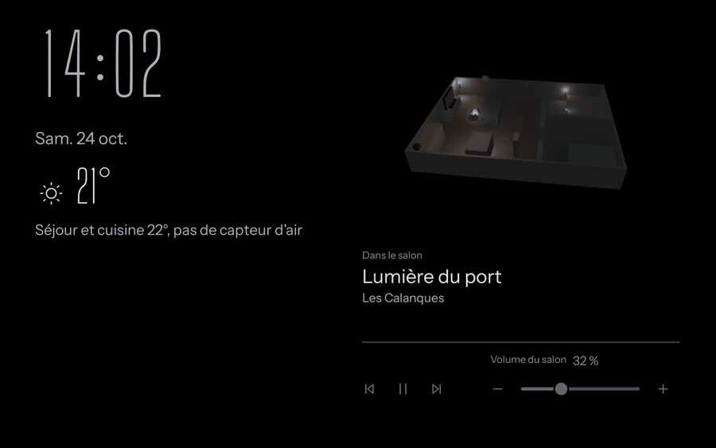
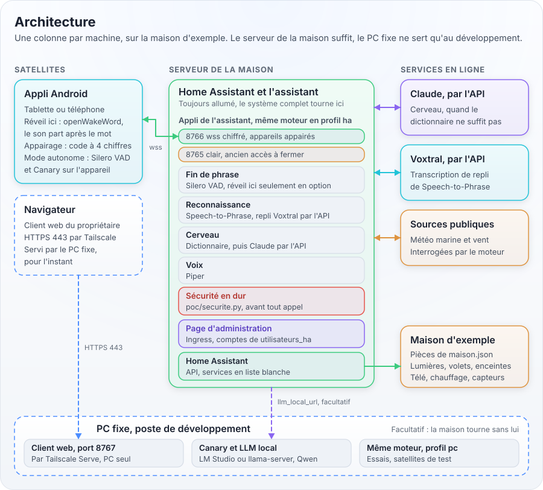
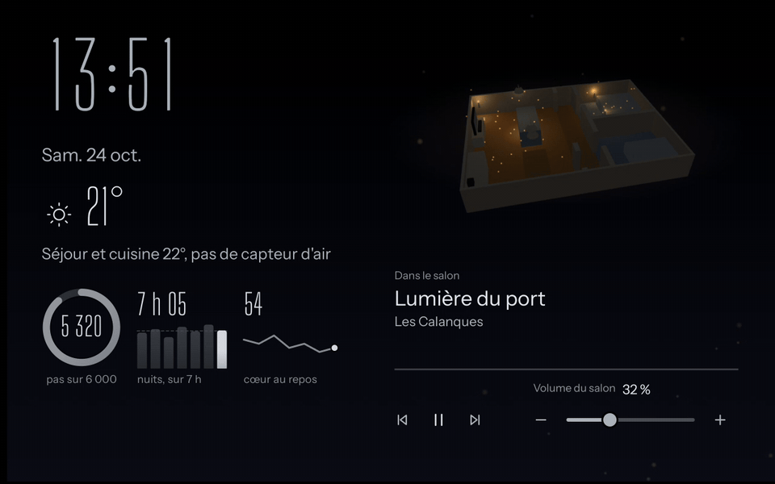
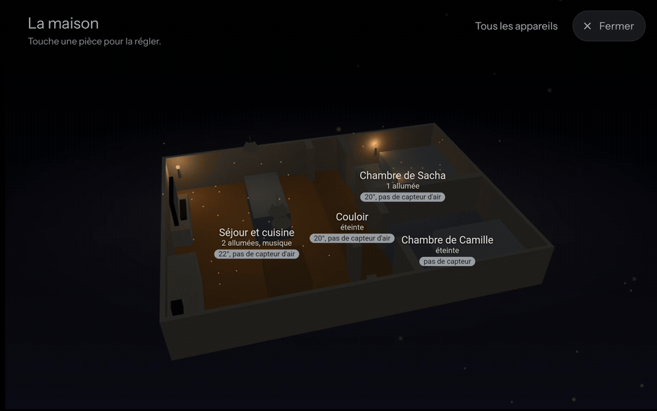
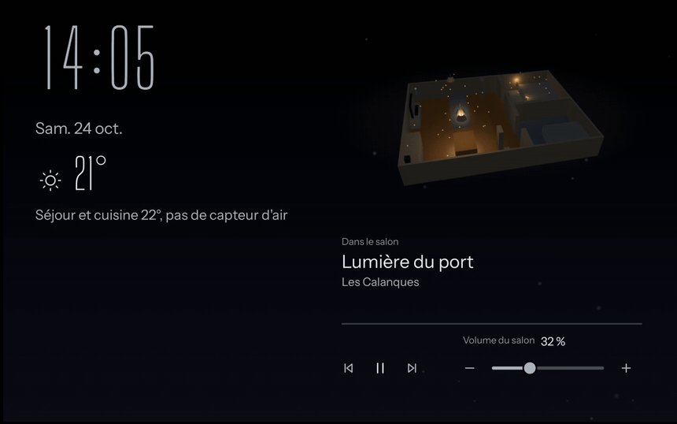
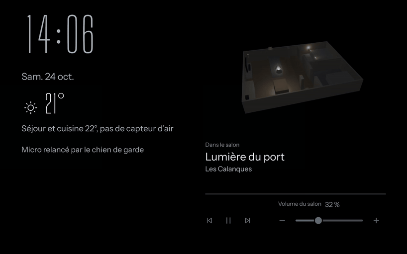

# Assistant vocal local

Un assistant vocal en français qui remplace Google Assistant dans un logement piloté par Home Assistant.
La voix reste à la maison : mot de réveil, détection de parole, transcription et dictionnaire de commandes
tournent sur la tablette, le téléphone ou le PC, et un LLM n'est appelé qu'en dernier recours, avec le texte
de la demande seulement.

<p align="center">
  
</p>

Ce dépôt est le moteur : il ne contient rien d'un logement réel. Chacun y branche sa propre configuration
(adresses, appareils, pièces, dictionnaire, plan, mot de réveil), rangée à part, de préférence dans son
propre dépôt privé. Tous les écrans de cette page montrent la configuration fictive `config-exemple/`.

## Comment ça marche

<picture>
  <source media="(prefers-color-scheme: dark)" srcset="docs/images/trajet-phrase-sombre.svg">
  
</picture>

Une phrase fréquente passe par le dictionnaire : environ 0,1 s pour la comprendre, et la lampe réagit dans la
foulée. Une phrase inconnue part au LLM avec ses outils, en 2 à 2,5 s avec Claude Haiku, puis elle est apprise et passe ensuite
par le dictionnaire. Avant chaque action, une sécurité écrite en dur peut refuser : service hors de la liste
blanche, appareil visé par son identifiant brut, volume au-delà de 50 %. Les durées sont des mesures,
détaillées dans [docs/ARCHITECTURE.md](docs/ARCHITECTURE.md).

## Les machines

<picture>
  <source media="(prefers-color-scheme: dark)" srcset="docs/images/architecture-sombre.svg">
  
</picture>

| Mode | Où tourne le serveur | Pour quoi |
|---|---|---|
| Cet appareil | Nulle part, l'appli Android fait tout | Une tablette ou un téléphone seul, Home Assistant joint par sa passerelle. |
| Serveur du PC | `poc/serveur_satellite.py` en profil pc | Les appareils servent de micros, le PC transcrit et décide. LLM local possible. |
| Appli Home Assistant | Le même serveur en profil ha, dans Home Assistant | Quand le PC est éteint, ou sans PC du tout. |

Les appareils parlent au serveur en WebSocket chiffré, après un appairage qui épingle la clé du serveur. Tailscale ne
sert qu'au relais facultatif des données de santé.

## Ce qui tourne où

| Composant | Machine | Matériel | Alternative en ligne | Licence |
|---|---|---|---|---|
| Mot de réveil openWakeWord ("Hey Jarvis" ou le sien) | Appareil, PC, Home Assistant | Léger : 2,4 Mo de prétraitement, 25 ms par bloc sur un cœur de tablette | Inutile | Apache 2.0, modèles selon leur fichier |
| Détection de parole Silero VAD | Appareil, serveur | Léger : 2,3 Mo, tourne partout | Inutile | MIT |
| Transcription Canary 1B | Appareil ou PC | 1 Go, 2,1 Go de mémoire sur l'appareil, 0,5 à 1,1 s par phrase | API compatible OpenAI (Voxtral de Mistral par défaut) | CC BY 4.0 |
| Transcription Speech-to-Phrase | Home Assistant | Petite machine : 0,7 à 1,4 s sur un petit serveur | Repli en ligne si rien n'est reconnu | Celle de l'appli Home Assistant |
| Dictionnaire de commandes | Appareil, serveur | Quelques dizaines de ms | Inutile | Ce dépôt |
| Voix Piper | PC, Home Assistant | Léger : 63 Mo, 0,2 s sur un PC, 0,7 s sur un petit serveur | Aucune codée | Voir la fiche de la voix |
| Voix d'Android | Appareil | Celle du système | Inutile | Celle du système |
| LLM Claude Haiku | En ligne, appelé par le serveur | Une connexion | Il est l'alternative | Conditions d'Anthropic |
| LLM local (llama-server, Qwen 3.5 9B) | PC | Carte graphique, 6,5 Go de mémoire vidéo, 2,7 à 3,8 s | Claude Haiku | Celle du modèle |
| LLM de l'appareil (LiteRT-LM, Gemma ou Qwen) | Appareil | Carte graphique de l'appareil | Claude Haiku par le serveur | Apache 2.0 |
| Visages YuNet et SFace | Appareil ou PC | Léger : 0,2 et 39 Mo, 16 à 28 ms par image | Aucune | MIT, Apache 2.0 |
| Plan 3D (three.js) | Appareil, dans une WebView | WebGL | Inutile | MIT |

Le détail de chaque composant, avec ce qu'il envoie sur le réseau : [docs/QUOI-TOURNE-OU.md](docs/QUOI-TOURNE-OU.md).

## Sans PC puissant

Le PC n'est pas obligatoire. Home Assistant sur une petite machine fait tourner l'appli du serveur en profil ha,
sans aucun modèle lourd. La tablette garde le mot de réveil et la détection de parole. Une clé Anthropic
remplace le LLM local, et une clé de transcription en ligne sert de repli à Speech-to-Phrase. Le son des phrases part
alors chez le fournisseur de transcription, et le texte chez Anthropic quand le dictionnaire ne suffit pas. Le
pas à pas et l'estimation du coût sont dans [docs/INSTALLER.md](docs/INSTALLER.md#12-variante--profil-sans-pc-puissant).

## Les écrans

<table>
  <tr>
    <td width="50%"><br><sub>Écran ambiant : heure, plan 3D, musique en cours.</sub></td>
    <td width="50%"><br><sub>La maison en grand : une lampe réglée, la télé allumée.</sub></td>
  </tr>
  <tr>
    <td width="50%"><br><sub>Météo, vent mesuré sur la carte du plan d'eau, prévisions marines.</sub></td>
    <td width="50%"><br><sub>Santé, affichée à son propriétaire seul devant l'écran (valeurs fictives).</sub></td>
  </tr>
</table>

Le plan 3D est généré depuis trois fichiers JSON de la configuration. Les principes de ces écrans (bleu de nuit
quand quelqu'un est là, noir pur dès qu'on s'éloigne pour ménager l'OLED, rien d'immobile, vie privée) sont dans
[docs/principes-design.md](docs/principes-design.md).

## Ce qui reste à la maison

| Donnée | Où elle va |
|---|---|
| Le son de la pièce | Nulle part avant le mot de réveil. Ensuite, la phrase seule, vers le serveur de la maison, et vers le service de transcription en ligne seulement si on l'a choisi. |
| Les images de la caméra | Sur la tablette, ou vers le PC de la maison en WebSocket chiffré. Jamais en ligne. |
| Les données de santé | Du relais santé vers la tablette, par Tailscale et en chiffré. Affichées seulement quand le propriétaire est seul devant l'écran. |
| Le texte de la demande | Vers Claude, seulement quand le dictionnaire ne l'a pas comprise, avec la liste des appareils permis. |
| Les secrets | Dans `poc/.env` de chaque machine, jamais dans un dépôt. Le garde-fou de `.githooks/` refuse tout secret, toute donnée d'usage et tout fichier de plus de 5 Mo. |

## Essayer

Le plus court pour essayer, sur la configuration fictive :

```bash
git config core.hooksPath .githooks
python -m venv .venv
.venv/Scripts/python -m pip install -r poc/requirements.txt
.venv/Scripts/python -m pytest poc/tests
```

Sous Linux ou macOS, `.venv/bin/python` remplace `.venv/Scripts/python`. L'installation complète, appli et
serveur compris, est dans [docs/INSTALLER.md](docs/INSTALLER.md).

## Documentation

| Document | Pour quoi |
|---|---|
| [docs/INSTALLER.md](docs/INSTALLER.md) | Installer pas à pas depuis une machine vierge : matériel, Python, `poc/.env`, appli Android, serveur, appli Home Assistant. |
| [docs/CONFIGURER.md](docs/CONFIGURER.md) | Décrire sa maison : chaque section de `maison.json`, le dictionnaire, le plan, les modules facultatifs. |
| [docs/ARCHITECTURE.md](docs/ARCHITECTURE.md) | Reprendre le code : blocs, protocole, sécurité, ajouter un écran ou un outil, tests, versions. |
| [docs/QUOI-TOURNE-OU.md](docs/QUOI-TOURNE-OU.md) | Chaque modèle, sa machine, sa taille, sa licence, ce qu'il envoie. |
| [docs/FAQ.md](docs/FAQ.md) | Dépannage, message d'erreur par message d'erreur. |

Versions et changements : `VERSION.md` pour le serveur, `android/VERSION.md` pour l'appli.

## Inspiration : assistant, des auteurs inspiration

Ce projet doit beaucoup à [assistant](https://github.com/projet-voisin/assistant), le miroir intelligent de la
famille des auteurs inspiration (un projet voisin, chaîne YouTube
[Les auteurs inspiration](https://www.exemple.invalid projet voisin)). Leur code est sous licence PolyForm
Noncommercial 1.0.0, leur modèle de mot de réveil sous CC BY-NC-SA 4.0.

- Le nom que l'appli donne encore à l'assistant, assistant, vient de chez eux.
- Leur mot de réveil "assistant", fabriqué par leur
  [générateur de mots de réveil](https://github.com/projet-voisin/wakeword-generator), n'est pas dans ce dépôt :
  chacun range le sien dans sa configuration (voir [docs/CONFIGURER.md](docs/CONFIGURER.md)).
- Plusieurs idées viennent de leur code : Silero VAD, liaison des téléphones durcie, arbitre entre appareils,
  entités permises données au LLM en liste fermée, état confirmé après chaque action, cas de test communs aux
  deux langages. Elles ont été réécrites, aucun fichier de leur code n'a été copié. Le comparatif est dans
  [inspirations/comparatif-projet_inspiration.md](inspirations/comparatif-projet_inspiration.md).

## Licence

Aucune licence pour l'instant : le code est de Alex Exemple1, tous droits réservés. Les modèles et le code
tiers gardent leur propre licence, détaillée dans [LICENCES-TIERS.md](LICENCES-TIERS.md).
